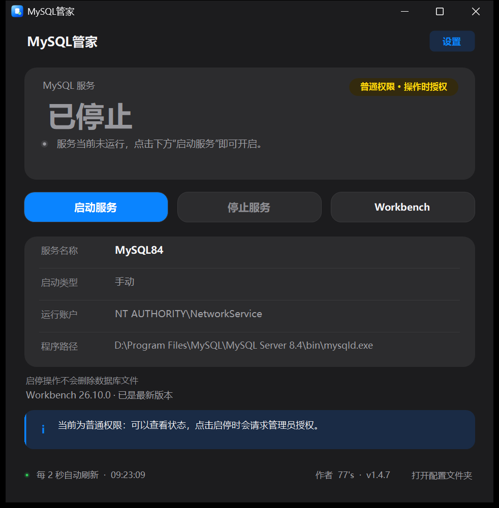
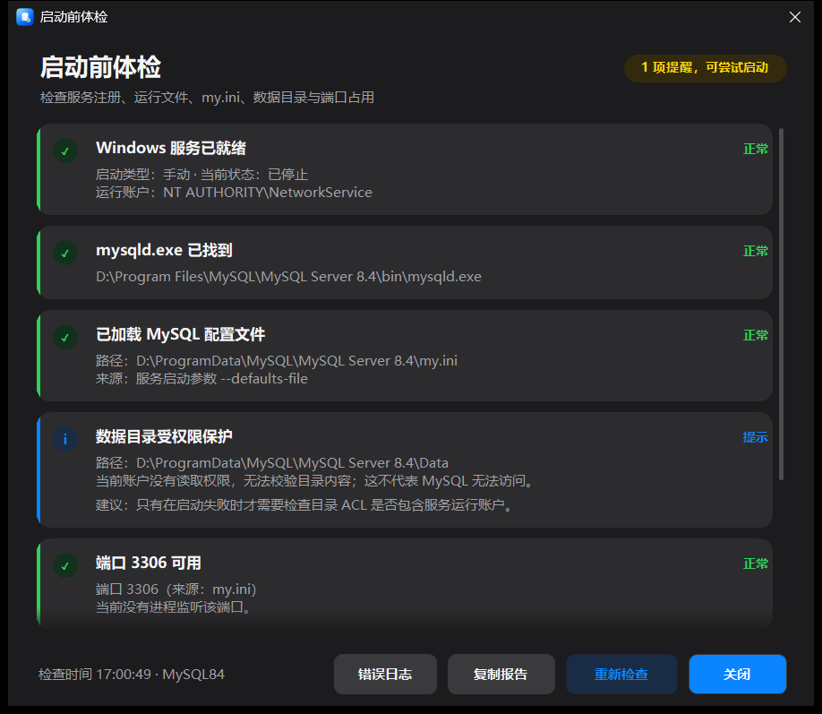
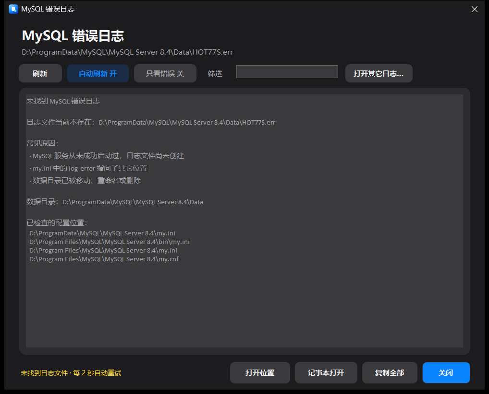
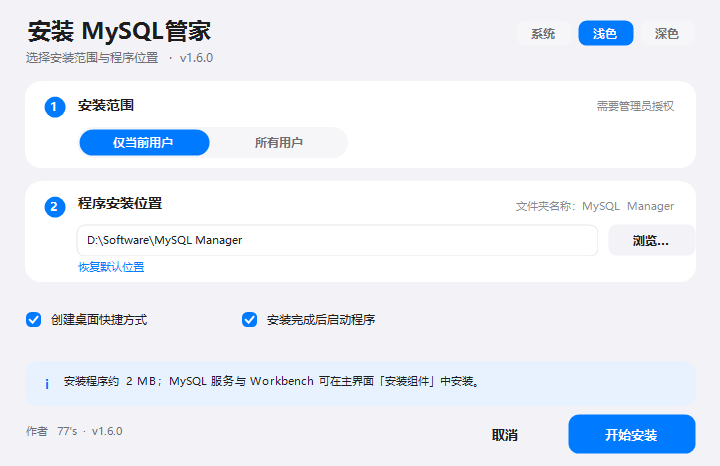
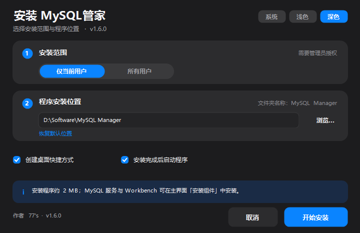

# MySQL管家

一个面向 Windows 的 MySQL 服务管理小工具：启动 / 停止服务、查看运行状态、打开 MySQL Workbench，并在启动前做体检、直接查看 MySQL 错误日志。

界面采用 macOS 风格的卡片与胶囊按钮，支持浅色 / 深色 / 跟随系统三档主题。



## 功能

- 启动 / 停止 Windows MySQL 服务，状态每 2 秒自动刷新
- 显示服务名称、启动类型、运行账户、`mysqld.exe` 路径
- **启动前体检**：检查服务注册、`mysqld.exe`、`my.ini`、数据目录、端口占用、错误日志与磁盘空间，提前指出启动失败的原因
- **错误日志查看器**：自动定位 `.err`，支持自动刷新、关键字筛选、只看错误 / 警告、错误行高亮，可打开所在文件夹或用记事本打开
- 一键打开 MySQL Workbench，并检查 Workbench 新版本
- 自动检测本机 MySQL / MariaDB 服务，可手动输入服务名
- 启动类型与运行账户只读展示，避免误改系统服务配置
- 浅色 / 深色 / 跟随系统主题
- 高 DPI 适配；窗口启动时按内容最小尺寸居中，可拖动
- **安装程序与主界面同风格**（跟随系统 / 浅色 / 深色），支持「仅当前用户 / 所有用户」安装，装完自动关闭
- **主界面内置「组件管理」**：安装或卸载 MySQL Server 和 MySQL Workbench。安装时可选版本和路径；初始化新 Server 时可选择是否设置 root 密码。
- **软件自更新**：标题栏右侧「检查更新」按钮，每次启动都会在后台检查一次；发现新版本时按钮左侧亮起一个小绿点（悬停可看版本号），可直接在软件内下载并静默安装，装完自动重新打开，配置与已装组件不受影响






## 系统要求

- Windows 10 / 11
- .NET Framework 4.8（Windows 10 1903+ 与 Windows 11 自带）
- 启动 / 停止 Windows 服务需要管理员权限；应用会在操作时请求提权

## 安装

从 [Releases](../../releases) 下载 `MySQL-Manager-1.6.4-Setup.exe`，双击运行。安装界面与主界面同一套风格，只有两步：

1. **安装范围**：仅当前用户（不需要管理员，默认装到 `%LOCALAPPDATA%\Programs\MySQL Manager`）；或所有用户（装到 `C:\Program Files\MySQL Manager`，开始安装时请求管理员授权）。
2. **程序安装位置**：安装文件夹名固定为 `MySQL Manager`，可改父目录。

安装程序只安装 MySQL管家 本体，装完自动关闭并按选项启动。MySQL 服务与 Workbench 在软件主界面里安装：



深色主题下是同一套布局：



## 管理 MySQL 组件

在主界面工具栏点击「组件管理」。安装时勾选组件并选择版本与安装位置，然后点击「开始安装」。

- **MySQL 服务**：默认最新版（内置 26.10.0 / 26.7.0 / 9.7.2 / 8.4.11 LTS / 8.0.45，启动时会联网核对 winget 清单），默认装到 `D:\Program Files\MySQL\MySQL Server <版本>`；初始化新实例时默认勾选「设置 root 密码」，安装前需输入并确认。也可以明确选择空密码（仅建议受控的本地开发环境），或取消初始化、只安装程序文件。已有实例的密码不会被修改。
- **MySQL Workbench**：版本 26.10.0 / 26.7.0，默认装到 `D:\Program Files\MySQL\MySQL Workbench <版本>`。
- 安装包按需从 `cdn.mysql.com` 下载（服务约 120–180 MB，Workbench 约 260 MB），窗口底部显示下载百分比与大小；普通权限下会请求一次 UAC，由隐藏的提权子进程完成安装。

卸载时，点击对应组件卡片上的「卸载」，选定已登记的 MSI 版本并确认。不直接删除数据库数据目录或 Workbench 用户配置；卸载 Server 前请先备份并确认允许中断连接。ZIP 解压等无 MSI 记录的安装不在卸载列表内。

静默安装（仅本程序）：

```bat
MySQL-Manager-1.6.4-Setup.exe --silent-install --install-dir "D:\Software\MySQL Manager"
MySQL-Manager-1.6.4-Setup.exe --silent-install --scope machine --no-launch
```

便携版可直接运行 `MySQLManager.exe`，但安装包会创建开始菜单 / 桌面快捷方式与卸载项。

## 使用

1. 打开软件，会自动读取当前配置的 MySQL 服务（默认 `MySQL84`）。
2. 如未检测到，点“自动检测”，或手动填写 `services.msc` 中的服务名。
3. 点“启动服务” / “停止服务”；首次操作会弹出 UAC 提权。
4. 启动失败时，点提示条上的“启动前体检”，或在主界面点“启动前体检”，查看具体原因。
5. “错误日志”可直接查看 MySQL 的 `.err` 文件，支持筛选与只看错误。
6. “Workbench” 按钮只打开 Workbench，不会启动数据库服务。
7. 设置页可修改服务名、`mysqld.exe` 路径与主题。
8. 标题栏右侧的“检查更新”按钮可以随时检查新版本（见下一节）。

配置保存在：

```
%LOCALAPPDATA%\MySQLManager\config.json
```

卸载会同时删除该配置目录，卸载前请自行备份。

## 检查更新

标题栏右侧、「设置」左边是「检查更新」按钮；发现新版本时，按钮左侧会亮起一个小绿点：

| 显示 | 含义 |
| --- | --- |
| `检查更新`（浅色描边） | 还没检查过、已是最新，或上次检查失败；点开可再查一次 |
| `检查更新` + 左侧小绿点 | 发现新版本，悬停可看版本号，点绿点或按钮都能打开更新窗口 |

点开后是“检查更新”窗口：显示新版本号、当前版本、发布日期、安装包大小与更新内容，底部显示会安装到哪个目录。

- **下载并安装**：在软件内下载安装包（约 400 KB，显示百分比与大小），下载完成后确认，程序会自动关闭、静默覆盖安装，装完自动重新打开新版本。
- 安装到“所有用户”目录时会请求一次 UAC；取消授权不会做任何更改。
- 提供“打开发布页面”链接，可绕过软件手动下载。
- 每次启动都会联网检查一次：先按上次结果点亮绿点，再后台确认；断网时保留上次结论，不会因为网络波动把提示弄丢。结果写入 `config.json` 的 `AppLatestVersion` / `AppCheckedUtc`。

检查与下载只访问 GitHub 的公开接口与 Releases：先读 `api.github.com` 的发布列表，被限流时退回 `releases/latest` 页面按命名规则拼出安装包地址。全程只读，不携带本机信息。

## 构建

需要 .NET SDK 8（用于编译）与 .NET Framework 4.8 目标包。

```bat
:: 主程序
dotnet build src/MySqlServiceController/MySQLServiceController.csproj -c Release

:: 安装器（先把主程序与说明放入 payload.*）
copy src\MySqlServiceController\bin\Release\MySQLManager.exe src\Installer\payload.app
copy src\MySqlServiceController\bin\Release\MySQLManager.exe.config src\Installer\payload.config
copy dist\1.6.4\使用说明.txt src\Installer\payload.guide
dotnet build src/Installer/Uninstall.csproj -c Release
```

产物：

- 主程序：`src/MySqlServiceController/bin/Release/MySQLManager.exe`
- 安装器：`src/Installer/bin/Release/MySQLServiceController-Setup.exe`

## 项目结构

```
src/MySqlServiceController/   主程序（WinForms）
src/Installer/                安装 / 卸载程序
assets/icons2/                应用图标母版（SVG / PNG / ICO）
docs/screenshots/             README 截图
CHANGELOG.md                  版本记录
更新说明-1.6.4.md              当前版本说明
```

## 说明

- 本项目只调用 Windows 服务控制接口与 MySQL 自带程序，不修改数据库文件。
- “停止服务”使用正常停止流程，不会删除数据。
- 应用不收集任何遥测数据；更新检查只读取 GitHub 上的公开发布信息。

## 许可证

[MIT](LICENSE)
