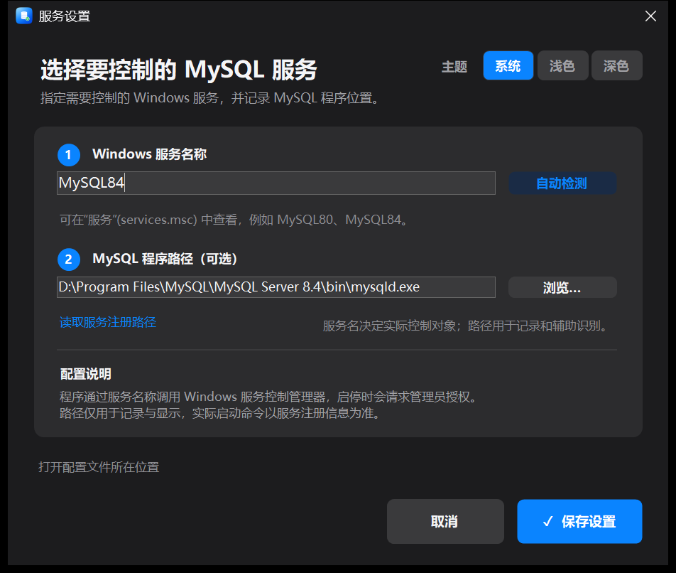

# MySQL管家

一个面向 Windows 的 MySQL 服务管理小工具：启动 / 停止服务、查看运行状态、打开 MySQL Workbench，并检查 Workbench 更新。

界面采用 macOS 风格的卡片与胶囊按钮，支持浅色 / 深色 / 跟随系统三档主题。


## 功能

- 启动 / 停止 Windows MySQL 服务，状态每 2 秒自动刷新
- 显示服务名称、启动类型、运行账户、`mysqld.exe` 路径
- 一键打开 MySQL Workbench，并检查 Workbench 新版本
- 自动检测本机 MySQL / MariaDB 服务，可手动输入服务名
- 启动类型与运行账户只读展示，避免误改系统服务配置
- 浅色 / 深色 / 跟随系统主题
- 高 DPI 适配；窗口启动时按内容最小尺寸居中，可拖动



## 系统要求

- Windows 10 / 11
- .NET Framework 4.8（Windows 10 1903+ 与 Windows 11 自带）
- 启动 / 停止 Windows 服务需要管理员权限；应用会在操作时请求提权

## 安装

从 [Releases](../../releases) 下载最新的 `MySQL管家-x.y.z-安装程序.exe`，按向导安装。

默认安装到 `%LOCALAPPDATA%\Programs\MySQLManager`；也可以指定目录：

```bat
MySQL管家-1.4.7-安装程序.exe --install-dir "D:\Software\MySQL Manager"
```

便携版可直接运行 `MySQLManager.exe`，但安装包会创建开始菜单 / 桌面快捷方式与卸载项。

## 使用

1. 打开软件，会自动读取当前配置的 MySQL 服务（默认 `MySQL84`）。
2. 如未检测到，点“自动检测”，或手动填写 `services.msc` 中的服务名。
3. 点“启动服务” / “停止服务”；首次操作会弹出 UAC 提权。
4. “Workbench” 按钮只打开 Workbench，不会启动数据库服务。
5. 设置页可修改服务名、`mysqld.exe` 路径与主题。

配置保存在：

```
%LOCALAPPDATA%\MySQLServiceController\config.json
```

卸载会同时删除该配置目录，卸载前请自行备份。

## 构建

需要 .NET SDK 8（用于编译）与 .NET Framework 4.8 目标包。

```bat
:: 主程序
dotnet build src/MySqlServiceController/MySQLServiceController.csproj -c Release

:: 安装器（先把主程序与说明放入 payload.*）
copy src\MySqlServiceController\bin\Release\MySQLManager.exe src\Installer\payload.app
copy src\MySqlServiceController\bin\Release\MySQLManager.exe.config src\Installer\payload.config
copy dist\1.4.7\使用说明.txt src\Installer\payload.guide
dotnet build src/Installer/Uninstall.csproj -c Release
```

产物：

- 主程序：`src/MySqlServiceController/bin/Release/MySQLManager.exe`
- 安装器：`src/Installer/bin/Release/MySQLServiceController-Setup.exe`

## 项目结构

```
src/MySqlServiceController/   主程序（WinForms）
src/Installer/                安装 / 卸载程序
assets/icons2/                应用图标母版（SVG / PNG / ICO）
docs/screenshots/             README 截图
CHANGELOG.md                  版本记录
更新说明-1.4.7.md              当前版本说明
```

## 说明

- 本项目只调用 Windows 服务控制接口与 MySQL 自带程序，不修改数据库文件。
- “停止服务”使用正常停止流程，不会删除数据。
- 应用不收集任何遥测数据。

## 许可证

[MIT](LICENSE)
